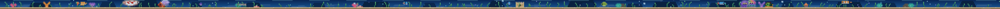

# Touch Bar Aquarium

[](https://github.com/quanphm/touchbar-aquarium/actions/workflows/ci.yml)
[](LICENSE)

A pixel-art freshwater aquarium that lives in the MacBook Pro Touch Bar (and
in a small preview window).



## What it is

A living little tank, ~30pt tall, rendered at 3× so every pixel is crisp on the
OLED strip: a **rich blue water gradient**, a **background of rocks, colorful
coral, sand castles, and layered reef silhouettes**, **dappled caustic light**, a swaying
plant bed, light rays, drifting **bioluminescent plankton**, and bubbling
columns. Corals and plankton **glow**, brightest after dark.

**The cast:** a striped **clownfish**, a round **pufferfish**, **two jellyfish**,
**three random schoolers** (from neon tetra, guppy, danio, platy, rasbora,
cherry barb, cory, angelfish, **betta**, **goldfish**), and **three legendary
residents**. Down on the sand live a **snail**, **two shrimp**, a **starfish**,
and a **crab**.

Also in the tank: a **day/night cycle** on a 20-minute clock (fish are lively
by day and languid by night, and the water dims), **species personalities**
(guppies and danios dart in bursts; the puffer inflates when startled), and
switchable **themes** (Freshwater / Deep Sea).

## The legendary residents

Every tank includes **three legendary residents**, wreathed in a soft glow and
trailing sparkles, gliding freely and grander than the rest: a red-and-white
***Kohaku*** koi, a ***Rainbow Mermaid***, and a ***Purple Mermaid***. They roam
the whole tank rather than holding a territory, and they never shoal.

## Smart habitat (TypeSafe / Jev)

**New Tank** doesn't just roll a random scene — it generates six candidate
habitats, asks [TypeSafe](https://docs.typesafe.ai)'s **System One** model
**Jev** to judge the composition of each in a single request, and keeps the
best. Code owns everything deterministic:

- **Code computes** the measurable features: rock/coral/anemone/plant counts,
  plant coverage, left/right mass, the largest open stretch, tallest plant.
- **Jev judges** five fuzzy dimensions per candidate — focal point, balance,
  open water (against fish count), theme coherence, and plant-bed density — as
  `Noul` and `Score` questions asked in parallel over one state.
- **Code combines** those answers with explicit weights (`LayoutScorer`) and
  picks the winner.

If there's no key, the network is down, or the request fails, it silently falls
back to `HeuristicHabitatJudge` — a pure-Swift version of the same score — so
the tank always builds. Jev never touches fish motion or rendering.

```sh
JEV_LIVE_TEST=1 swift run aquarium-checks
```

## Build & run

```sh
# Live app + figures out the Touch Bar at runtime
./Scripts/build-app.sh release
open "Build/Touch Bar Aquarium.app"
```

Or, without bundling:

```sh
swift run AquariumBar
```

## Dev loop (no GUI, no Touch Bar needed)

Render frames straight to PNG so you can eyeball the art:

```sh
swift run aquarium-render --strip 6 --step 0.6 --out out/strip.png --scale 3
```

Any `--out` ending in `.gif` writes an animated GIF instead of a static
PNG — frames captured `1 / fps` seconds apart, looping forever:

```sh
swift run aquarium-render --theme freshwater --seed 42 --scale 6 --fps 12 --strip 96 --out out/freshwater.gif
```

Options: `--strip N` frames, `--step` seconds between them, `--warmup` seconds
before capture, `--scale` integer upscale, `--fps N` playback rate for GIFs,
`--feed X` drop food at column X,
`--viewport W --camera X` render a W-wide window of the wide tank,
`--theme freshwater|deepsea`, `--hour H` pin the time of day, `--seed N` pin
the world, `--legendary` force a legendary resident, and `--sprites` to render
the cast as a lineup instead of a tank.

Every sprite in the game, in one strip:


