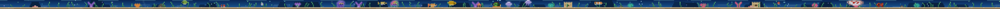
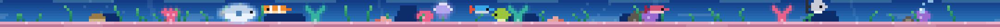
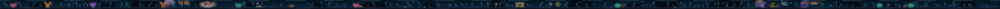

# Touch Bar Aquarium

[](https://github.com/quanphm/touchbar-aquarium/actions/workflows/ci.yml)
[](LICENSE)

A pixel-art freshwater aquarium that lives in the MacBook Pro Touch Bar (and
in a small preview window). Built with Swift + AppKit, no Xcode required —
Command Line Tools are enough.



## What it is

A living little tank, ~30pt tall, rendered at 3× so every pixel is crisp on the
OLED strip: a **rich blue water gradient**, a **background of rocks, colorful
coral, and distant reef silhouettes**, **dappled caustic light**, a swaying
plant bed, light rays, drifting motes, and a bubble column. Corals glow softly
for a bioluminescent feel.

**The cast:** a striped **clownfish**, a round **pufferfish**, a pulsing,
glowing **jellyfish**, **three random schoolers** (from neon tetra, guppy,
danio, platy, rasbora, cherry barb, cory, angelfish), and one **legendary
resident**. Down on the sand live a **snail** and **two shrimp**.

Fish swim to their own destinations, hold a preferred depth and pace, keep
their distance, avoid the glass, and rise to food you drop. Each fish keeps a
**hidden fullness tracker**: when it's full it ignores food and drifts away,
then gets hungry again as it digests. The jellyfish
ignores all that — it pulses upward, sinks, and drifts.

Also in the tank: a **day/night cycle** (fish are lively by day and languid by
night, and the water dims), **species personalities** (guppies and danios dart
in bursts; the puffer inflates when startled), and switchable **themes**
(Freshwater / Deep Sea).

## The legendary resident

Every tank includes a **legendary koi**: a big, elegant carp wreathed in a soft
glow and trailing sparkles, gliding slower and grander than the rest. It comes
in five varieties — *Kohaku*, *Showa*, *Ogon*, *Tancho*, or *Asagi* — and its
name shows in the menu-bar menu.

Render it to PNG:

```sh
swift run aquarium-render --scale 6 --out out/tank.png
```

## Themes

Switch live from the menu-bar **Theme** submenu.

**Freshwater**


**Reef** — royal-blue water over pink sand


**Deep Sea** — cold and bioluminescent


> Rendered at 6× straight from the simulation; the Touch Bar shows the same tank at 3×.

## Always-on vs frontmost

Apple's public `NSTouchBar` API only shows your bar while your app is the
frontmost app. To keep the tank visible **while you work in other apps**, the
app uses Apple's private *system-modal* Touch Bar API (the same mechanism Pock,
MTMR, and BetterTouchTool use):

- `NSTouchBar.presentSystemModalTouchBar(_:placement:systemTrayItemIdentifier:)`
- `DFRElementSetControlStripPresenceForIdentifier` / `DFRSystemModalShowsCloseBoxWhenFrontMost`

The private calls are resolved purely at runtime (Objective-C runtime + `dlsym`
in `Sources/TouchBarPrivate`), so nothing private is linked at build time and
the app degrades to frontmost-only if the API ever disappears.

> ⚠️ Private API means this is **not App Store distributable**, and Apple could
> change it in future macOS releases. It is a personal-use hack, exactly like
> Pock/MTMR.

### Controlling it

The app runs as a background (menu-bar) app — look for the **fish icon in the
menu bar**:

- **Always show on Touch Bar** — toggle the system-modal mode (on by default).
- **Show Preview Window** — a normal window with the same tank.
- **Theme** — switch between *Freshwater*, *Deep Sea*, and *Reef* (royal-blue water + pink sand).
- **New Tank** — re-roll a whole fresh tank (new layout, fish, and legendary).
  Six candidate layouts are generated and the best is chosen by **Jev** (see
  *Smart habitat* below), falling back to on-device heuristics with no key.
- **Quit Touch Bar Aquarium**.

A **fish icon is also added to the Control Strip** (right side of the Touch
Bar); tap it to re-show the tank if it ever gets covered.


## Smart habitat (TypeSafe / Jev)

**New Tank** doesn't just roll a random scene — it generates six candidate
habitats, asks [TypeSafe](https://docs.typesafe.ai)'s **System One** model
**Jev** to judge the composition of each in a single request, and keeps the
best. Code owns everything deterministic:

- **Code computes** the measurable features: rock/coral/anemone/plant counts,
  plant coverage, left/right mass, the largest open stretch, tallest plant.
- **Jev judges** five fuzzy dimensions per candidate — focal point, balance,
  open water (against fish count), theme coherence, and plant-bed density — as
  `Noul` and `Score` questions asked in parallel over one state.
- **Code combines** those answers with explicit weights (`LayoutScorer`) and
  picks the winner.

If there's no key, the network is down, or the request fails, it silently falls
back to `HeuristicHabitatJudge` — a pure-Swift version of the same score — so
the tank always builds. Jev never touches fish motion or rendering.

```sh
# Prove the live request path end-to-end:
JEV_LIVE_TEST=1 swift run aquarium-checks
```


## Layout

```
Sources/
  AquariumCore/     Pure, headless, unit-tested. Imports no UI framework.
    Sim.swift       AquariumSim — the deep module (tick / feed / poke + state)
    Render.swift    render(sim, into: Frame) — pure pixels
    Sprite.swift    PixelSprite — ASCII art + palette -> pixels
    Art.swift       Every color and sprite, in one place
    Frame.swift     RGBA8 image
    Random.swift    Seedable PRNG (deterministic worlds)
  AquariumJev/      Ranks candidate habitats with Jev (HTTP), or on-device
    LayoutSnapshot.swift   Text/JSON description of a tank's decor + plants
    HabitatJudge.swift     Judge protocol, weighted scorer, offline fallback
    JevClient.swift        Minimal POST /v1/systemone client
    JevHabitatJudge.swift  The composition questions + weighted pick
    JevKey.swift           Where the API key comes from
  AquariumBar/      Thin AppKit adapter at the seam
    Controller.swift         owns the sim, ticks it at 30fps, notifies views
    TankView.swift           NSView that blits frames (nearest-neighbour, 3×)
    TouchBarHost.swift       builds the NSTouchBar content
    SystemModalPresenter.swift  always-on adapter (private API)
    App.swift                menu-bar app + preview window
  TouchBarPrivate/  Objective-C shim for the private system-modal API
  AquariumRender/   Dev tool: renders the sim to PNG (no GUI needed)
  AquariumChecks/   Self-contained checks (works without XCTest/Xcode)
```

## Build & run

```sh
# Live app + figures out the Touch Bar at runtime
./Scripts/build-app.sh release
open "Build/Touch Bar Aquarium.app"
```

Or, without bundling:

```sh
swift run AquariumBar
```

Quit with **⌘Q** in the preview window (or `pkill -9 -f AquariumBar`).

## Dev loop (no GUI, no Touch Bar needed)

Render frames straight to PNG so you can eyeball the art:

```sh
swift run aquarium-render --strip 6 --step 0.6 --out out/strip.png --scale 3
```

Options: `--strip N` frames, `--step` seconds between them, `--warmup` seconds
before capture, `--scale` integer upscale, `--feed X` drop food at column X.

## Checks

```sh
swift run aquarium-checks
```

Proves the deep module's contract through its interface: stable fish count,
fish never leave the tank, determinism for a fixed seed, food gets eaten (and a
full fish ignores it until it digests), poking scatters fish, and bounds hold in
a cramped tank. It also covers the habitat judge: layout snapshots are
deterministic per seed, the plant-bed utility peaks at "comfortable", selection
picks the highest total and resolves ties, the heuristic judge is deterministic,
the key file is read and trimmed, and a failing judge falls back.

## Design notes

`AquariumSim` is the deep module: a tiny interface (`tick`, `feed`, `poke`,
plus read-only `fish`/`bubbles`/`pellets`/`plants`) hiding a lot of behavior —
wandering, separation, boundary steering, food seeking, fleeing, bubble
emission, plant layout. Because it imports nothing, it runs headless in tests
*and* in the PNG tool.

`TankView` is deliberately dumb: it renders sim state to a `Frame` and blits
it. The preview window and the Touch Bar item are the *same* `TankView`, so
they can never drift apart.

## Touch Bar facts (measured on MacBookPro17,1 / 13" M1)

- Principal item area: **1085 × 30 pt** when the control strip is visible.
- Art canvas is **360 × 10**, drawn at integer 3× → 1080 × 30.

## Roadmap

- [x] Deep headless sim + pure renderer
- [x] PNG dev tool + checks
- [x] Preview window
- [x] Touch Bar via public `NSTouchBar` (visible while the app is frontmost)
- [x] **Always-on** adapter (private DFR system-modal API) so the tank stays
      in the bar while you work in other apps
- [ ] More species, feeding/poke tuning, day-night tint, save/restore
- [ ] Optional: launch at login
